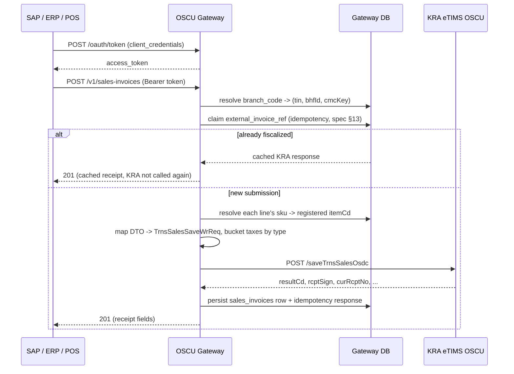

# SAP / ERP Integration Guide

This is the contract for a source system (SAP, another ERP, a POS system) integrating
against the OSCU Gateway. You never need to know KRA's field names, endpoint paths, or
response codes — only what's documented here. See `KRA_OSCU_FastAPI_Integration_Spec.md`
§9.2/§16 for the design principle this follows.

## Two supported integration patterns (spec §16)

1. **SAP PI/PO or Cloud Integration (CPI) as the transport layer.** SAP emits an IDoc
   (`INVOIC02`/custom) or OData call on billing document release → PI/PO/CPI transforms it
   to the JSON shapes below → HTTPS POST to the gateway. This is the usual choice: most
   integration platforms have native OAuth2 client-credentials support, so no custom code is
   needed for auth.
2. **Custom ABAP** calling the gateway directly via `cl_http_client`, using OAuth2
   client-credentials (below), triggered on `VF01` (invoice) save or a batch job.

Either way, the source system only needs this document — never the KRA spec itself.

## Authentication (spec §15)

OAuth2 client-credentials grant. Your integration team gives you a `client_id` and
`client_secret` (see the main README's "Onboarding a new client"); you exchange them for a
short-lived bearer token and send that on every other request:

```http
POST /oauth/token
Content-Type: application/x-www-form-urlencoded

grant_type=client_credentials&client_id=<your client_id>&client_secret=<your client_secret>
```
```json
{"access_token": "eyJhbGciOi...", "token_type": "bearer", "expires_in": 1800}
```

```http
POST /v1/sales-invoices
Authorization: Bearer eyJhbGciOi...
Content-Type: application/json
```

Tokens expire (`expires_in` seconds, 1800 by default) — request a new one when a call
returns `401`, don't try to refresh; there's no refresh-token grant, just re-request with
the same `client_id`/`client_secret`.

Every credential you were issued is scoped to specific branches
(`clients.allowed_branch_ids`) — a valid token proves who you are, not that you can act on
every branch. A `branch_code` you weren't granted returns `403`.

## Common response shapes

- **Success** — the endpoint's own JSON body (documented per-endpoint below).
- **`401`** — missing/invalid/expired token. Get a new one.
- **`403`** — your client isn't allowed to act on that `branch_code`.
- **`404`** — unknown `branch_code`, or (for `GET`) the resource doesn't exist.
- **`402`** — your organization's subscription with the gateway operator has lapsed or been
  suspended (billing, not KRA) — contact your account rep, not KRA support. `detail` explains
  why (no subscription on file, suspended with a reason, or past its grace period).
- **`409`** — (sales invoices only) the same `external_invoice_ref` is already being
  processed by a concurrent request. Retry shortly.
- **`422`** — validation error, a referenced `sku` isn't registered yet (register it via
  `POST /v1/items` first), a friendly code (e.g. `unit_of_measure`) doesn't match anything
  KRA has published, **or** your organization isn't permitted to use the specific code you
  sent (see [Per-customer code restrictions](#per-customer-code-restrictions) below) — the
  `detail` field tells you which case it is; these are not something retrying fixes, the
  request itself needs a different value.
- **`429`** — rate limit exceeded (spec §15). Back off and retry.
- **`502`** — KRA itself rejected or failed the call. `detail` includes KRA's own
  `resultCd`/`resultMsg` (spec §10) for your logs; this is not something retrying
  immediately will usually fix.

## Endpoints

### Register an item — `POST /v1/items`

```json
{
  "branch_code": "NAIROBI-HQ",
  "sku": "BREAD-400G",
  "name": "Bread 400g",
  "item_classification_cd": "5020150101",
  "unit_of_measure": "BA",
  "packaging_unit": "NT",
  "product_type": "FINISHED_PRODUCT",
  "tax_category": "STANDARD16",
  "unit_price": "100.00",
  "origin_nation_cd": "KE",
  "insurance_applicable": false
}
```

- `product_type`: `RAW_MATERIAL` | `FINISHED_PRODUCT` | `SERVICE`
- `tax_category`: `EXEMPT` | `STANDARD16` | `ZERO` | `NONVAT` | `8PCT`
- `unit_of_measure` / `packaging_unit` / `origin_nation_cd` / `item_classification_cd`: each
  either a value matching a cached KRA code's name (see
  [Reference data](#reference-data) below, e.g. `GET /v1/codes/quantity-unit` or
  `GET /v1/item-classes`), or the raw KRA code directly if you already know it — all four are
  validated against the cache, not passed through blindly. `origin_nation_cd` defaults to
  `"KE"` if omitted.
- Posting the same `sku` again **updates** the existing item rather than creating a
  duplicate — the gateway reuses its previously-assigned `item_cd`.
- All five of the above (`unit_of_measure`, `packaging_unit`, `tax_category`,
  `item_classification_cd`, `origin_nation_cd`) are also checked against any restriction your
  organization's gateway admin has configured — see
  [Per-customer code restrictions](#per-customer-code-restrictions).

Response (`201`):
```json
{
  "branch_code": "NAIROBI-HQ", "sku": "BREAD-400G", "item_cd": "KE2NTBA0000001",
  "item_cls_cd": "5020150101", "name": "Bread 400g", "tax_category_cd": "B",
  "unit_price": "100.00", "kra_synced_at": "2026-01-01T12:00:00Z"
}
```

`GET /v1/items?branch_code=NAIROBI-HQ` lists everything registered for that branch (omit
`branch_code` to list every branch your client is allowed to see).

### Submit a sales invoice — `POST /v1/sales-invoices`

**Synchronous** — the response includes the fiscal receipt proof, so you have it before the
HTTP call returns (spec §14's own recommendation, since you typically need it immediately to
print a compliant receipt). Every `sku` referenced must already be registered.

```json
{
  "branch_code": "NAIROBI-HQ",
  "external_invoice_ref": "SAP-BILLDOC-0001",
  "customer_pin": "P123456789A",
  "customer_name": "John Customer",
  "payment_method": "CASH",
  "invoice_date": "2026-01-01",
  "lines": [
    {
      "sku": "BREAD-400G", "description": "Bread 400g", "quantity": "2",
      "unit_of_measure": "BA", "unit_price": "100.00", "discount_pct": "0",
      "tax_category": "STANDARD16"
    }
  ]
}
```

- `external_invoice_ref` is your idempotency key (spec §13) — typically the SAP billing
  document number. Resubmitting the same value returns the same cached response instead of
  fiscalizing twice; **always send the same ref for retries of the same invoice**, never a
  fresh one, or you'll create a duplicate fiscal receipt.
- Tax buckets (KRA's `taxblAmt`/`taxAmt` A-E split) are computed for you from each line's
  `tax_category` — you never construct them yourself.
- `payment_method`: same "cached code or raw KRA code" rule as `unit_of_measure` above
  (`GET /v1/codes/payment-method`); spec §7 only fully documents `CASH`/`OTHER` (`01`/`07`)
  of the seven codes, so the others must come from what KRA's own code list returns.
- `tax_category` on each line is independently re-checked against your organization's
  restriction (if one is configured — see
  [Per-customer code restrictions](#per-customer-code-restrictions)), even for a `sku` whose
  `tax_category` was already accepted at registration — it's resupplied per line here, not
  read back from the registered item, so send the same value you registered the item with
  unless you have a specific reason not to.

Response (`201`):
```json
{
  "external_ref": "SAP-BILLDOC-0001", "branch_code": "NAIROBI-HQ", "status": "FISCALIZED",
  "kra_cur_rcpt_no": 1, "kra_tot_rcpt_no": 1,
  "kra_rcpt_sign": "2222-2222-2222-2222", "kra_intrl_data": "1111-1111-1111-1111-1111-1111-11",
  "kra_sdc_datetime": "20200226143124",
  "kra_sdc_id": "KRACU0300004030", "kra_cu_invoice_no": "KRACU0300004030/1",
  "qrcode_link": "https://etims-sbx.kra.go.ke/common/link/etims/receipt/indexEtimsReceiptData?Data=A123456789Z00<rcptSign>",
  "scu_information": {
    "date": "26/02/2020 14:31:24",
    "control_unit_number": "KRACU0300004030",
    "invoice_number": "KRACU0300004030/1",
    "internal_data": "1111-1111-1111-1111-1111-1111-11",
    "receipt_signature": "2222-2222-2222-2222",
    "receipt_number": 1
  }
}
```

Print `kra_rcpt_sign`/`kra_intrl_data`/`kra_cur_rcpt_no`/`kra_sdc_datetime`/`kra_sdc_id`/
`kra_cu_invoice_no` on the receipt, and render `qrcode_link` as a QR code (not as clickable
text) — this is the full fiscal proof TIS-OSCU-VSCU-v2.0 spec §6.23 requires:
- `kra_rcpt_sign`/`kra_intrl_data` are already dash-grouped every 4 characters, matching
  KRA's own printed-receipt convention (§6.23.6/§6.23.7) and its verification page exactly —
  print them as given, don't strip the dashes or reformat them yourself. The QR code
  (`qrcode_link`) is built from the underlying raw signature internally; you never need the
  raw form.
- `kra_sdc_id` is the receipt's "CU ID" (§6.23.3), and `kra_cu_invoice_no` is the "CU Invoice
  Number" (§6.23.4) — just `kra_sdc_id` + `"/"` + `kra_cur_rcpt_no`, provided pre-built so you
  don't need to construct it yourself.
- `qrcode_link` is a scannable verification URL (§6.23.8 / the spec's sample receipt layout),
  built from `tin` + `bhfId` + `rcptSign` — see `app/services/kra_receipt.py` if you need the
  exact construction. Can be `null` if `kra_rcpt_sign` isn't available yet — don't assume it's
  always present. The host itself (shown above as the sandbox one, `etims-sbx.kra.go.ke`)
  switches to the production host automatically once the gateway's own `KRA_ENV` is set to
  `production` — nothing on the client/SAP side changes.
- `scu_information` is the same data again, pre-formatted to match KRA's own "SCU Information"
  receipt block **exactly** (confirmed field-for-field against a real receipt's KRA
  verification page) — `internal_data`/`receipt_signature` are already grouped in dashes every
  4 characters (§6.23.6/§6.23.7) and `date` is already `DD/MM/YYYY HH:MM:SS`. Print this block
  as given rather than reformatting the top-level `kra_*` fields yourself. `null` whenever
  `kra_rcpt_sign` is.

`GET /v1/sales-invoices/{external_ref}?branch_code=...` looks all of this up again later.

### Submit a credit note — `POST /v1/sales-invoices/credit-notes`

Reverses/credits a prior sale. KRA models this as its own fiscal transaction (not a mutation
of the original invoice), so it gets its own `external_invoice_ref` and its own receipt proof,
same response shape as a plain sale above (including `qrcode_link`/`kra_sdc_id`/
`kra_cu_invoice_no`).

```json
{
  "branch_code": "NAIROBI-HQ",
  "external_invoice_ref": "CN-0001",
  "original_invoice_ref": "SAP-BILLDOC-0001",
  "reason": "Refund",
  "customer_pin": "P123456789A",
  "customer_name": "John Customer",
  "lines": [
    {
      "sku": "BREAD-400G", "description": "Bread 400g", "quantity": "1",
      "unit_of_measure": "BA", "unit_price": "100.00", "tax_category": "STANDARD16"
    }
  ]
}
```

- `original_invoice_ref` must match an already-**fiscalized** sale's `external_invoice_ref` —
  the gateway resolves KRA's `orgInvcNo` from it via its own records. `422` if it doesn't
  resolve to a fiscalized sale (wrong ref, or it references another credit note instead of a
  sale — credit notes can't themselves be credited).
- `external_invoice_ref` here is the credit note's **own** idempotency key — a separate
  namespace from the original sale's ref (reusing the sale's own ref is not the same thing and
  isn't supported).
- `reason`: same "cached code or raw KRA code" rule as other friendly fields — see
  `GET /v1/codes/credit-note-reason`.

Response `201`, same shape as a sales invoice, plus `transaction_kind: "CREDIT_NOTE"` and
`original_ref` set to the sale it's crediting. Look it up later with
`GET /v1/sales-invoices/{external_ref}?branch_code=...&transaction_kind=CREDIT_NOTE` — the
`transaction_kind` query param must be passed explicitly (it defaults to `"SALE"`), since sales
and credit notes are independent ref namespaces even though they share the same lookup table.

### Purchases, stock, imports — asynchronous (outbox pattern, spec §14)

These return `202 Accepted` immediately with a tracking status; the actual KRA submission
happens in the background (with retry/backoff on transient failures). Poll the relevant
`GET` endpoint if you need to confirm completion.

- `GET /v1/purchases/pending?branch_code=...` — supplier sales KRA told us about, awaiting
  your confirmation.
- `POST /v1/purchases` — confirm one, referencing it by `spplr_tin`/`spplr_invc_no`:
  ```json
  {"branch_code": "NAIROBI-HQ", "external_ref": "PO-0001",
   "spplr_tin": "P987654321B", "spplr_invc_no": "SUP-INV-0001", "pchs_ty_cd": "N"}
  ```
  (`pchs_ty_cd` is a raw KRA Transaction Type code — spec §7 doesn't document any of its
  four values' meanings, only the bare letters `C`/`N`/`P`/`T`, so there's no friendly
  crosswalk to offer; ask KRA/your integration team which applies.)
- `POST /v1/stock/movements` — a stock in/out event:
  ```json
  {"branch_code": "NAIROBI-HQ", "external_ref": "SIO-0001", "sar_ty_cd": "02",
   "lines": [{"sku": "BREAD-400G", "quantity": "10", "unit_price": "100.00"}]}
  ```
  (`sar_ty_cd`: spec §7 gives only the ranges — `01`-`06` incoming, `11`-`16` outgoing — not
  individual meanings.)
- `POST /v1/stock/master` — set an item's remaining quantity:
  ```json
  {"branch_code": "NAIROBI-HQ", "sku": "BREAD-400G", "remaining_quantity": "48"}
  ```
- `GET /v1/imports?branch_code=...` / `POST /v1/imports/{taskCd}/decision` — customs import
  items KRA declared, and approving/rejecting one:
  ```json
  {"branch_code": "NAIROBI-HQ", "item_cls_cd": "5020150101",
   "item_cd": "KE1BGKG0000005", "decision_cd": "3"}
  ```
  (`decision_cd`: `1` Unsent / `2` Waiting / `3` Approved / `4` Cancelled — spec §12.16.)

### Branch master data

`POST /v1/branches/customers`, `/users`, `/insurance` — direct pass-throughs, no crosswalk
needed (every field maps 1:1 to its KRA counterpart). See
`app/api/v1/endpoints/branches.py` for the exact field list per endpoint; all three follow
the same `{"branch_code": "...", ...KRA-shaped fields in snake_case...}` shape.

### Reference data

`GET /v1/codes/{classification}` — cached KRA code tables, never a live KRA call. Common
`classification` slugs: `tax-type`, `payment-method`, `quantity-unit`, `packaging-unit`,
`nation`, `product-type` (see `CLASSIFICATION_SLUGS` in
`app/services/code_cache_service.py` for the full list) — or the raw KRA `cdCls` number
directly (e.g. `04` for tax type) if you already know it.

```json
[
  {"cd": "B", "cd_nm": "16%", "cd_desc": "Standard Rate", "srt_ord": 2, "use_yn": "Y", "refreshed_at": "..."}
]
```

`GET /v1/item-classes` — the full item-classification list (~1000 rows, a 3-level
UNSPSC-style hierarchy: `item_cls_cd` is an 8-digit code, e.g. `50180000` = "Bread and bakery
products" under the `50000000` "Food and Beverage Products" segment). No query params on this
endpoint — fetch once and filter/search client-side, or page through it yourself.

```json
[
  {"item_cls_cd": "50180000", "item_cls_nm": "Bread and bakery products", "item_cls_lvl": "2", "tax_ty_cd": null, "mjr_tg_yn": null, "use_yn": "Y", "refreshed_at": "..."}
]
```

`GET /v1/notices?branch_code=...` — KRA notices (spec §6.2), read-only.

**Both of these are already filtered to what your organization is permitted to submit**, if
your gateway operator has configured a restriction — see the next section. If no restriction
is configured for a given field (the default), you see every cached code, same as always.
Populate dropdowns/validation straight from these two endpoints; what comes back is exactly
what a submission using one of those codes will be allowed to use.

### Per-customer code restrictions

Your gateway operator can restrict which specific codes your organization is allowed to
submit for `unit_of_measure`, `packaging_unit`, `tax_category`, `item_classification_cd`, and
`origin_nation_cd`. This is configured per paying customer account (i.e. shared across every
`client_id` your organization was issued), not per individual credential.

**Most integrations are unaffected** — a restriction only exists if your gateway operator
explicitly configured one; by default every code in the reference data above is usable.

If a restriction *is* configured, `GET /v1/codes/{classification}` and `GET /v1/item-classes`
(above) already come back pre-filtered to your allowed subset — so in the normal case you
never need to think about this at all, your dropdowns are just narrower. The only time it
surfaces directly is if something in your own system still submits a code from before a
restriction was tightened: `POST /v1/items` or `POST /v1/sales-invoices` then returns `422`:

```json
{"detail": "Customer is not permitted to use 'tax-type' code 'C'"}
```

The classification name in the message (`'tax-type'` above) matches a `GET
/v1/codes/{classification}`-style slug, telling you which field to reconsider — re-fetch that
endpoint to see the current allowed set.

## Sequence diagram: submitting a sales invoice



Purchases/stock/imports follow the same shape up through "map DTO -> KRA request", but then
write to an outbox table and return `202` immediately — the actual KRA call happens in a
background worker (spec §14), not inline in the request.
