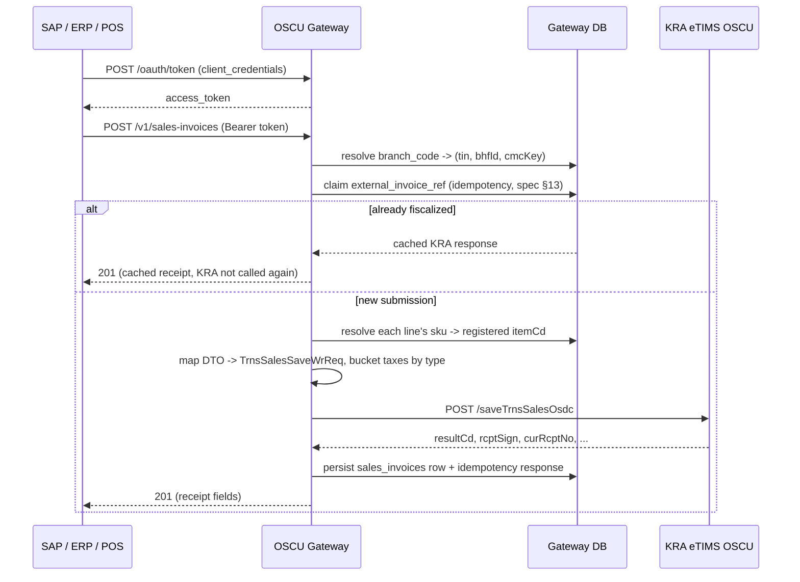

# SAP / ERP Integration Guide

This is the contract for a source system (SAP, another ERP, a POS system) integrating
against the OSCU Gateway. You never need to know KRA's field names, endpoint paths, or
response codes — only what's documented here. See `KRA_OSCU_FastAPI_Integration_Spec.md`
§9.2/§16 for the design principle this follows.

## Two supported integration patterns (spec §16)

1. **SAP PI/PO or Cloud Integration (CPI) as the transport layer.** SAP emits an IDoc
   (`INVOIC02`/custom) or OData call on billing document release → PI/PO/CPI transforms it
   to the JSON shapes below → HTTPS POST to the gateway. This is the usual choice: most
   integration platforms have native OAuth2 client-credentials support, so no custom code is
   needed for auth.
2. **Custom ABAP** calling the gateway directly via `cl_http_client`, using OAuth2
   client-credentials (below), triggered on `VF01` (invoice) save or a batch job.

Either way, the source system only needs this document — never the KRA spec itself.

## Authentication (spec §15)

OAuth2 client-credentials grant. Your integration team gives you a `client_id` and
`client_secret` (see the main README's "Onboarding a new client"); you exchange them for a
short-lived bearer token and send that on every other request:

```http
POST /oauth/token
Content-Type: application/x-www-form-urlencoded

grant_type=client_credentials&client_id=<your client_id>&client_secret=<your client_secret>
```
```json
{"access_token": "eyJhbGciOi...", "token_type": "bearer", "expires_in": 1800}
```

```http
POST /v1/sales-invoices
Authorization: Bearer eyJhbGciOi...
Content-Type: application/json
```

Tokens expire (`expires_in` seconds, 1800 by default) — request a new one when a call
returns `401`, don't try to refresh; there's no refresh-token grant, just re-request with
the same `client_id`/`client_secret`.

Every credential you were issued is scoped to specific branches
(`clients.allowed_branch_ids`) — a valid token proves who you are, not that you can act on
every branch. A `branch_code` you weren't granted returns `403`.

## Common response shapes

- **Success** — the endpoint's own JSON body (documented per-endpoint below).
- **`401`** — missing/invalid/expired token. Get a new one.
- **`403`** — your client isn't allowed to act on that `branch_code`.
- **`404`** — unknown `branch_code`, or (for `GET`) the resource doesn't exist.
- **`409`** — (sales invoices only) the same `external_invoice_ref` is already being
  processed by a concurrent request. Retry shortly.
- **`422`** — validation error, or a referenced `sku` isn't registered yet (register it via
  `POST /v1/items` first), or a friendly code (e.g. `unit_of_measure`) doesn't match
  anything KRA has published. The `detail` field explains which.
- **`429`** — rate limit exceeded (spec §15). Back off and retry.
- **`502`** — KRA itself rejected or failed the call. `detail` includes KRA's own
  `resultCd`/`resultMsg` (spec §10) for your logs; this is not something retrying
  immediately will usually fix.

## Endpoints

### Register an item — `POST /v1/items`

```json
{
  "branch_code": "NAIROBI-HQ",
  "sku": "BREAD-400G",
  "name": "Bread 400g",
  "item_classification_cd": "5020150101",
  "unit_of_measure": "BA",
  "packaging_unit": "NT",
  "product_type": "FINISHED_PRODUCT",
  "tax_category": "STANDARD16",
  "unit_price": "100.00",
  "origin_nation_cd": "KE",
  "insurance_applicable": false
}
```

- `product_type`: `RAW_MATERIAL` | `FINISHED_PRODUCT` | `SERVICE`
- `tax_category`: `EXEMPT` | `STANDARD16` | `ZERO` | `NONVAT` | `8PCT`
- `unit_of_measure` / `packaging_unit`: either a value matching a cached KRA code's name
  (see `GET /v1/codes/{classification}`, e.g. `GET /v1/codes/quantity-unit`), or the raw
  2-letter KRA code directly if you already know it.
- Posting the same `sku` again **updates** the existing item rather than creating a
  duplicate — the gateway reuses its previously-assigned `item_cd`.

Response (`201`):
```json
{
  "branch_code": "NAIROBI-HQ", "sku": "BREAD-400G", "item_cd": "KE2NTBA0000001",
  "item_cls_cd": "5020150101", "name": "Bread 400g", "tax_category_cd": "B",
  "unit_price": "100.00", "kra_synced_at": "2026-01-01T12:00:00Z"
}
```

`GET /v1/items?branch_code=NAIROBI-HQ` lists everything registered for that branch (omit
`branch_code` to list every branch your client is allowed to see).

### Submit a sales invoice — `POST /v1/sales-invoices`

**Synchronous** — the response includes the fiscal receipt proof, so you have it before the
HTTP call returns (spec §14's own recommendation, since you typically need it immediately to
print a compliant receipt). Every `sku` referenced must already be registered.

```json
{
  "branch_code": "NAIROBI-HQ",
  "external_invoice_ref": "SAP-BILLDOC-0001",
  "customer_pin": "P123456789A",
  "customer_name": "John Customer",
  "payment_method": "CASH",
  "invoice_date": "2026-01-01",
  "lines": [
    {
      "sku": "BREAD-400G", "description": "Bread 400g", "quantity": "2",
      "unit_of_measure": "BA", "unit_price": "100.00", "discount_pct": "0",
      "tax_category": "STANDARD16"
    }
  ]
}
```

- `external_invoice_ref` is your idempotency key (spec §13) — typically the SAP billing
  document number. Resubmitting the same value returns the same cached response instead of
  fiscalizing twice; **always send the same ref for retries of the same invoice**, never a
  fresh one, or you'll create a duplicate fiscal receipt.
- Tax buckets (KRA's `taxblAmt`/`taxAmt` A-E split) are computed for you from each line's
  `tax_category` — you never construct them yourself.
- `payment_method`: same "cached code or raw KRA code" rule as `unit_of_measure` above
  (`GET /v1/codes/payment-method`); spec §7 only fully documents `CASH`/`OTHER` (`01`/`07`)
  of the seven codes, so the others must come from what KRA's own code list returns.

Response (`201`):
```json
{
  "external_ref": "SAP-BILLDOC-0001", "branch_code": "NAIROBI-HQ", "status": "FISCALIZED",
  "kra_cur_rcpt_no": 1, "kra_tot_rcpt_no": 1,
  "kra_rcpt_sign": "2222222222222222", "kra_intrl_data": "11111111111111111111111111",
  "kra_sdc_datetime": "20200226143124"
}
```

Print `kra_rcpt_sign`/`kra_intrl_data`/`kra_cur_rcpt_no`/`kra_sdc_datetime` on the receipt —
this is the fiscal proof (spec §6.6). `GET /v1/sales-invoices/{external_ref}?branch_code=...`
looks it up again later.

### Purchases, stock, imports — asynchronous (outbox pattern, spec §14)

These return `202 Accepted` immediately with a tracking status; the actual KRA submission
happens in the background (with retry/backoff on transient failures). Poll the relevant
`GET` endpoint if you need to confirm completion.

- `GET /v1/purchases/pending?branch_code=...` — supplier sales KRA told us about, awaiting
  your confirmation.
- `POST /v1/purchases` — confirm one, referencing it by `spplr_tin`/`spplr_invc_no`:
  ```json
  {"branch_code": "NAIROBI-HQ", "external_ref": "PO-0001",
   "spplr_tin": "P987654321B", "spplr_invc_no": "SUP-INV-0001", "pchs_ty_cd": "N"}
  ```
  (`pchs_ty_cd` is a raw KRA Transaction Type code — spec §7 doesn't document any of its
  four values' meanings, only the bare letters `C`/`N`/`P`/`T`, so there's no friendly
  crosswalk to offer; ask KRA/your integration team which applies.)
- `POST /v1/stock/movements` — a stock in/out event:
  ```json
  {"branch_code": "NAIROBI-HQ", "external_ref": "SIO-0001", "sar_ty_cd": "02",
   "lines": [{"sku": "BREAD-400G", "quantity": "10", "unit_price": "100.00"}]}
  ```
  (`sar_ty_cd`: spec §7 gives only the ranges — `01`-`06` incoming, `11`-`16` outgoing — not
  individual meanings.)
- `POST /v1/stock/master` — set an item's remaining quantity:
  ```json
  {"branch_code": "NAIROBI-HQ", "sku": "BREAD-400G", "remaining_quantity": "48"}
  ```
- `GET /v1/imports?branch_code=...` / `POST /v1/imports/{taskCd}/decision` — customs import
  items KRA declared, and approving/rejecting one:
  ```json
  {"branch_code": "NAIROBI-HQ", "item_cls_cd": "5020150101",
   "item_cd": "KE1BGKG0000005", "decision_cd": "3"}
  ```
  (`decision_cd`: `1` Unsent / `2` Waiting / `3` Approved / `4` Cancelled — spec §12.16.)

### Branch master data

`POST /v1/branches/customers`, `/users`, `/insurance` — direct pass-throughs, no crosswalk
needed (every field maps 1:1 to its KRA counterpart). See
`app/api/v1/endpoints/branches.py` for the exact field list per endpoint; all three follow
the same `{"branch_code": "...", ...KRA-shaped fields in snake_case...}` shape.

### Reference data

`GET /v1/codes/{classification}` — cached KRA code tables, never a live KRA call. Common
`classification` slugs: `tax-type`, `payment-method`, `quantity-unit`, `packaging-unit`,
`product-type` (see `CLASSIFICATION_SLUGS` in `app/services/code_cache_service.py` for the
full list) — or the raw KRA `cdCls` number directly (e.g. `04` for tax type) if you already
know it.

`GET /v1/notices?branch_code=...` — KRA notices (spec §6.2), read-only.

## Sequence diagram: submitting a sales invoice



Purchases/stock/imports follow the same shape up through "map DTO -> KRA request", but then
write to an outbox table and return `202` immediately — the actual KRA call happens in a
background worker (spec §14), not inline in the request.
